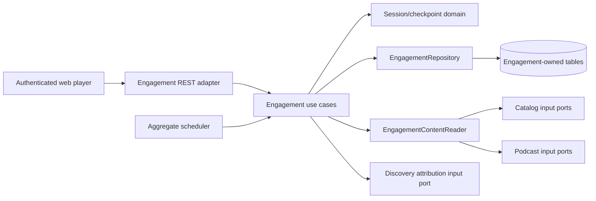

# Architecture Design Doc — `engagement`

> **Status:** Active development · **PRD source:** `BACKEND-PRD.md` §6.3A ·
> **Work unit:** WU-ENG-1 · **Package root:** `org.shakvilla.beatzmedia.engagement`

## 1. Purpose and boundary

The engagement module owns authenticated listening sessions, immutable checkpoints, personal
Recently Played state, podcast resume state, history privacy controls, and anonymous daily engagement
aggregates. Anonymous playback is still allowed, but anonymous history is client-local.

Engagement is not playback accounting. It never writes `play_event`, grants ownership, or posts money.
The existing `POST /v1/tracks/{id}/play` remains the only counted-play entry point. A
`qualified-play` engagement event is behavioral data, not royalty evidence.

## 2. Dependencies

The module follows adapter → application → domain. Cross-module IDs are opaque `TEXT` references;
there are no cross-module foreign keys, repository calls, JPA entities, or table reads. Content is
resolved only through a narrow reader port implemented by integration adapters.

## 3. Domain rules

- Durable sessions require an authenticated account.
- Every account has a preference row before its first durable session.
- Preference, checkpoint, and erasure writes lock the preference row first.
- `(sessionId, sequence)` is the idempotency key.
- An exact retry succeeds without another write.
- Reusing a sequence with a different payload is a conflict.
- A previously unseen sequence below the session maximum is stored as ineffective diagnostics.
- Only an effective checkpoint updates progress or an aggregate.
- Cross-session progress follows latest server-accepted activity.
- Explicit completion or position at least 95% of duration completes an item.
- Continue Listening requires a podcast position of at least 10 seconds and not completed.

## 4. Ports

### Input

- `StartListeningSession`
- `IngestListeningCheckpoint`
- `GetRecentlyPlayed`
- `GetContinueListening`
- `GetListeningPreference`
- `UpdateListeningPreference`
- `ClearListeningHistory`
- `ProjectEngagementAggregates`

### Output

- `EngagementRepository`
- `EngagementContentReader`
- discovery `RecordRecommendationOutcome`
- platform `Clock`
- platform `IdGenerator`

The content reader supports batch resolution for personal-history pages. It returns availability,
display metadata, and authoritative duration, never another module's domain entity.

## 5. Persistence

`V993__authenticated_engagement_history.sql` owns:

- `listening_preference`
- `listening_session`
- `listening_checkpoint`
- `listening_progress`
- `engagement_daily_rollup`

Checkpoint ingestion uses a short transaction and preference-first lock ordering. The aggregate
projector uses `FOR UPDATE SKIP LOCKED` and atomically increments a daily rollup and marks its source
checkpoint projected. Personal reads use composite keyset indexes; pending projection uses a partial
index.

## 6. HTTP surface

All routes require authentication:

- `POST /v1/me/listening-sessions`
- `PUT /v1/me/listening-sessions/{sessionId}/checkpoints/{sequence}`
- `GET /v1/me/listening/recent`
- `GET /v1/me/listening/continue`
- `GET|PUT /v1/me/listening/settings`
- `DELETE /v1/me/listening/history`

Another account's session is indistinguishable from a missing session (`404`). Exact retries and stale
sequences return `204`; conflicting sequence reuse returns `409`; invalid positions, durations, or
event types return `422`.

Checkpoints may include an optional `recommendationId`. After authoritative content resolution,
Engagement passes effective start, qualified-play, and completion checkpoints plus the resolved
release/show parent ID to Discovery. The call runs independently and is best-effort: missing,
expired, mismatched, or unavailable attribution never rejects a checkpoint or affects playback.

## 7. Privacy and erasure

Disabling history deletes sessions, checkpoints, and progress, then prevents later durable writes.
Clearing history performs the same erasure without changing the preference. Anonymous aggregate rows
already committed remain because they contain no account or session identifier. Deleted checkpoints
cannot participate in a future rebuild.

Creators and admins may consume only `engagement_daily_rollup`. Logs and metrics must not include raw
account/content activity payloads.

## 8. Verification contract

- Duplicate and concurrent retries create one checkpoint.
- Out-of-order checkpoints cannot regress progress or inflate aggregates.
- Two projector workers cannot double count.
- Opt-out and erasure serialize against ingestion.
- Account A cannot observe or mutate account B's session.
- Engagement operations leave playback, ownership, and ledger tables unchanged.
- Architecture rules reject domain framework dependencies and cross-module persistence access.

The detailed approved design and test matrix are in
`docs/plans/2026-11-02-authenticated-engagement-history-design.md`.
