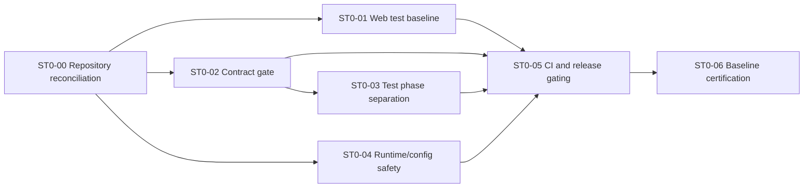

# Stage 0 Delivery Baseline — Implementation Backlog

**Date:** 2026-11-01  
**Status:** Ready for work-unit registration after repository reconciliation  
**Parent design:** `2026-11-01-web-release-to-fan-delivery-sequence-design.md`  
**Objective:** Establish a clean, truthful, releasable web/backend baseline before durable publication and engagement work begins.

## 1. Stage 0 outcome

Stage 0 is complete when BeatzClik has:

- a reviewable repository baseline with provider changes either merged, isolated, or parked;
- a green Node 22 web build and all 351 web tests passing;
- honest unit, integration, contract, migration, architecture, and smoke gates;
- contract CI that cannot pass with zero tests;
- verified CORS behavior for the documented API;
- production configuration that fails closed when required secrets are absent;
- release publishing gated on the complete required CI result;
- a recorded baseline evidence report that unblocks Stage 1.

Stage 0 does not implement outbox, engagement, Following, discovery ranking, generalized support, or creator campaigns.

## 2. Provider-work disposition

The current working tree mixes six `in_progress` provider work units with unrelated mobile and generated artifacts. Stage 0 must not treat compile success as completion.

| Existing work unit | Stage 0 decision | Required outcome |
|---|---|---|
| WU-EXT-1 provider selection | Reconcile now | Isolate into its intended review unit; run focused and integration tests; merge or park completely. |
| WU-EXT-2 payment pinning | Reconcile now | Preserve money/ownership invariants; verify mid-flight selection and disabled-state behavior; merge or park completely. |
| WU-EXT-3 S4 adapter | Reconcile now | Keep MinIO green; do not claim production S4 readiness without credentialed evidence. Merge safe compatibility work or park. |
| WU-EXT-4 durable media location | Reconcile now | Mixed-store reads may merge only with migration/rollback scope accurately documented. Bulk migration tooling may remain unfinished but cannot be represented as done. |
| WU-EXT-5 Resend transport | Reconcile now | Verify provider pinning, retry semantics, redaction, and local SMTP regression; merge or park completely. |
| WU-EXT-6 password-reset email | Reconcile now | Verify enumeration resistance, token secrecy, and both local/selected transports; merge or park completely. |
| WU-EXT-7 FROG SMS | Defer | Not required for the first web music/podcast journey. Keep `todo`. |
| WU-EXT-8 hosted card checkout | Move to Stage 5 | Required for later purchase/support completeness, not Stage 0. Keep `todo`. |
| WU-EXT-9 full activation runbook | Defer/split evidence | Each merged provider supplies its own evidence. The combined activation gate remains blocked until EXT-7/8 are intentionally resumed. |

No Stage 0 work unit may silently change an EXT status to `done`. The existing backlog rule remains: done means merged and all required checks green.

## 3. Dependency graph



`ST0-01`, `ST0-02`, and `ST0-04` may proceed independently after repository reconciliation. `ST0-03` follows the contract classification so test moves and tag changes are performed once. `ST0-05` consumes the final job names and commands. `ST0-06` is the only Stage 1 gate.

## 4. Work units

## ST0-00 — Repository reconciliation and baseline manifest

**Owner:** tech lead  
**Complexity:** Large  
**Depends on:** none  
**Blocks:** every other Stage 0 work unit

### Outcome

Turn the current transitional working tree into a set of reviewable changes without losing user work or mixing unrelated concerns.

### Scope

1. Capture the complete tracked, staged, untracked, and ignored state.
2. Identify which files belong to EXT-1 through EXT-6.
3. Identify generated/runtime artifacts that belong to no work unit.
4. Preserve the mobile tree for later work but exclude it from Stage 0 commits.
5. Park the uncommitted mobile CI job with the mobile work; do not leave a required job pointing at an untracked application.
6. Partition provider changes according to the existing dependency graph.
7. Resolve migration ownership and ordering for V982–V986.
8. Produce a baseline manifest listing:
   - file ownership by work unit;
   - migration ownership;
   - shared-file conflicts;
   - tests already run;
   - missing evidence;
   - merge, park, or defer decision.
9. Restore a branch state where each proposed commit has one purpose.

### Important files

- `backend/.project/backlog.yaml`
- `docs/plans/provider-integrations/`
- `backend/src/main/resources/db/migration/V982__provider_selection.sql`
- `backend/src/main/resources/db/migration/V983__payments_gateway_pinning.sql`
- `backend/src/main/resources/db/migration/V984__pin_email_provider_on_delivery_attempt.sql`
- `backend/src/main/resources/db/migration/V985__delivery_attempt_provider_message_id.sql`
- `backend/src/main/resources/db/migration/V986__provider_runtime_configuration.sql`
- `backend/src/main/resources/application.properties`
- `backend/docker-compose.yml`
- `API-CONTRACT.md`
- `.github/workflows/ci.yml`

### Acceptance criteria

- No user-authored file is deleted or overwritten during reconciliation.
- `errorlog.txt`, `mobile/errors.txt`, build output, and local OS artifacts are absent from product commits.
- Mobile files are preserved but excluded from Stage 0 work units.
- Mobile CI is parked with the deferred mobile baseline and is reintroduced only when that application is deliberately committed and qualified.
- Each EXT change is attributable to one work unit or a documented shared prerequisite.
- Migrations are forward-only, uniquely owned, and apply from an empty database.
- EXT-1 through EXT-6 each have a merge/park decision and explicit remaining evidence.
- The repository baseline can be reproduced from committed work plus documented local configuration.

### Verification

- `git status --short`
- `git diff --check`
- migration clean/migrate/validate
- backend compile
- focused provider tests named in the provider implementation plan

### Non-goals

- Completing FROG SMS.
- Completing hosted card checkout.
- Activating production providers.
- Implementing new product features.

## ST0-01 — Restore the green Node 22 web baseline

**Owner:** frontend developer  
**Complexity:** Small  
**Depends on:** ST0-00

### Outcome

Make the existing web application build and all 351 tests pass under the repository-pinned Node 22 runtime.

### Scope

1. Fix the Studio release-detail fixture/mapper contract:
   - determine whether `tracks` is required by the real detail API;
   - make the wire type match the contract;
   - update fixtures to use complete detail payloads;
   - do not hide a backend contract regression by defaulting required data to an empty list.
2. Make unavailable-player recovery deterministic:
   - remove timing dependence from the `PlayerBar` retry test;
   - verify the enabled recovery control appears after a failed stream request;
   - preserve the honest unavailable state.
3. Enforce Node 22 for local scripts and CI documentation.
4. Preserve the current production build behavior while recording the existing bundle-size warning as a later performance item.

### Important files

- `Frontend/.nvmrc`
- `Frontend/package.json`
- `Frontend/src/lib/api/queries/studio.ts`
- `Frontend/src/lib/api/queries/studio.test.ts`
- `Frontend/src/features/player/components/unavailable-notice.test.tsx`
- `Frontend/src/features/player/player-context.tsx`
- `Frontend/src/components/player/player-bar.tsx` or its current equivalent

### Acceptance criteria

- `npm run build` succeeds using Node 22.17.1.
- `npx vitest run --reporter=default` reports 46 passing files and 351 passing tests.
- Studio detail mapping is proven against the actual API contract shape.
- Player recovery test passes repeatedly without increasing the global timeout.
- No test-only production fallback is introduced.
- Node 25 is not treated as a supported local runtime unless separately qualified.

### Verification

```bash
cd Frontend
node --version
npm ci
npm run build
npx vitest run --reporter=default
```

### Non-goals

- Bundle splitting.
- Player feature expansion.
- New Studio features.

## ST0-02 — Make the API contract gate non-vacuous

**Owner:** backend engineer  
**Complexity:** Medium  
**Depends on:** ST0-00

### Outcome

Guarantee that the `contract-test` CI job executes the intended API-contract suite and fails when the selected suite is empty.

### Scope

1. Define the canonical contract-test classification:
   - apply `@Tag("contract")` consistently to all `*ContractTest` classes, or
   - configure a dedicated Maven execution using an unambiguous naming pattern.
2. Avoid a split-brain setup where class names say contract but CI selects tags that are absent.
3. Add an explicit executed-test-count assertion in CI.
4. Ensure generated OpenAPI is available to contract tests and uploaded as evidence.
5. Document whether contract tests use Quarkus, PostgreSQL, MinIO, and seeded data.
6. Keep contract tests out of the fast unit command.

### Current evidence

- 21 `*ContractTest.java` classes exist.
- Zero tests currently declare `@Tag("contract")`.
- CI runs `verify -DskipITs=false -Dgroups=contract`.
- Ordinary `mvn test` currently executes contract-style Quarkus tests.

### Important files

- `.github/workflows/ci.yml`
- `backend/pom.xml`
- `backend/src/test/java/**/*ContractTest.java`
- `backend/docs/sdlc/testing-strategy.md`
- `backend/docs/sdlc/ci-cd-github-actions.md`
- `API-CONTRACT.md`

### Acceptance criteria

- The contract job reports a non-zero expected test count.
- Removing or misclassifying all contract tests makes CI fail.
- A deliberately broken API response shape fails at least one contract test.
- Contract tests do not run in the fast unit command.
- Contract suite membership is mechanically discoverable.
- Documentation and workflow commands agree.

### Verification

- contract-selection dry run;
- mutation of one response field in a temporary verification branch;
- CI-equivalent contract command;
- report inspection proving test count.

### Non-goals

- Expanding every endpoint’s contract coverage in this work unit.
- Rewriting the API contract format.

## ST0-03 — Separate unit, integration, contract, and architecture phases

**Owner:** backend engineer  
**Complexity:** Large  
**Depends on:** ST0-02

### Outcome

Make each backend test command execute only the class of tests named by its CI job, with predictable infrastructure and duration.

### Scope

1. Define classification rules:
   - unit: framework-light domain/application tests, no Docker;
   - integration: `*IT`, Quarkus/Testcontainers/real adapters;
   - contract: API conformance tests;
   - architecture: ArchUnit only.
2. Move or rename Quarkus tests that currently end in `Test` but require infrastructure.
3. Configure Surefire excludes/includes and Failsafe includes explicitly.
4. Preserve coverage collection without double instrumentation.
5. Ensure Quarkus contract tests run in exactly one intended phase.
6. Record expected test counts per phase to detect accidental disappearance.
7. Keep migrations and real media tests in their intended integration gates.

### Important files

- `backend/pom.xml`
- `.github/workflows/ci.yml`
- `backend/src/test/java/`
- `backend/src/test/resources/` if profile configuration is introduced
- `backend/docs/sdlc/testing-strategy.md`

### Acceptance criteria

- `./mvnw test` does not connect to Docker or launch Quarkus Dev Services.
- Integration tests run under Failsafe and include required PostgreSQL/MinIO/ffmpeg coverage.
- Contract tests execute exactly once in the contract job.
- ArchUnit tests execute exactly once in the architecture job.
- Coverage remains at or above the existing gates.
- The complete backend verification still covers the current 1,512-test baseline or documents intentional deduplication without coverage loss.
- Each job publishes its own test report and non-zero test count.

### Verification

- Docker disabled: unit command remains green.
- CI-equivalent integration command with Docker.
- CI-equivalent contract command.
- CI-equivalent architecture command.
- Coverage profile and report.
- Full verification comparison against the pre-change class/test inventory.

### Non-goals

- Rewriting tests solely for style.
- Reducing integration coverage to make unit tests faster.

## ST0-04 — Correct CORS and production configuration safety

**Owner:** backend engineer with security review  
**Complexity:** Medium  
**Depends on:** ST0-00

### Outcome

Make the documented web API callable with its actual HTTP methods and prevent production startup with development credentials or keys.

### Scope

1. Replace deprecated/unrecognized Quarkus CORS keys with the configuration supported by Quarkus 3.38.1.
2. Include `PUT` because library, settings, profile, and other documented endpoints require it.
3. Restrict production origins, headers, and credentials explicitly.
4. Add integration coverage for browser preflight on representative `GET`, `POST`, `PUT`, `PATCH`, and `DELETE` routes.
5. Remove production fallback behavior for:
   - database password;
   - MinIO/S3 access and secret keys;
   - JWT private/public keys;
   - payment webhook secret;
   - provider runtime-configuration encryption key where required.
6. Add production startup validation with clear, redacted errors.
7. Preserve safe local/test defaults through profile-specific configuration.
8. Update deployment preflight documentation to match application startup requirements.

### Important files

- `backend/src/main/resources/application.properties`
- `backend/docker-compose.yml`
- `backend/src/main/java/.../platform/` startup validation code
- `backend/src/test/java/...` CORS and configuration tests
- `backend/docs/sdlc/environments-and-deployment.md`
- `.github/workflows/deploy.yml`

### Acceptance criteria

- Quarkus no longer reports the configured CORS key as unrecognized.
- A permitted web origin can preflight and call representative `PUT` endpoints.
- An unapproved origin is rejected in the production profile.
- Production startup fails when any required secret is missing.
- Production startup does not fall back to dev JWT keys, MinIO credentials, or webhook secrets.
- Logs and health responses never reveal secret values.
- Dev/test startup remains documented and usable.

### Verification

- production-profile negative startup matrix;
- dev/test positive startup;
- REST-assured preflight tests;
- configuration log inspection;
- compose and deploy preflight comparison.

### Non-goals

- Provider activation.
- General security-platform redesign.

## ST0-05 — Gate release publishing on the complete CI result

**Owner:** DevOps/tech lead  
**Complexity:** Medium  
**Depends on:** ST0-01, ST0-02, ST0-03, ST0-04

### Outcome

Prevent image publication or release creation when any required validation job fails or has not completed.

### Scope

1. Replace the representative `build`-only wait with a complete CI workflow gate.
2. Choose one robust model:
   - release triggered by successful `workflow_run` for the exact commit; or
   - a required aggregate `ci-success` job that depends on every mandatory job.
3. Keep tag releases tied to a commit that has the same verified CI evidence.
4. Include backend, frontend, security, migration, and compose-smoke gates. Mobile is explicitly outside this certified baseline and must not appear as a required job until the deferred mobile work resumes.
5. Make compose smoke assert the existing catalog endpoint as mandatory.
6. Record the tested commit SHA in image metadata and release notes.
7. Ensure deploy consumes the intended immutable image tag.
8. Preserve manual deployment approval and fail-closed environment-secret behavior.

### Important files

- `.github/workflows/ci.yml`
- `.github/workflows/security.yml`
- `.github/workflows/release.yml`
- `.github/workflows/deploy.yml`
- `backend/docs/sdlc/ci-cd-github-actions.md`
- `backend/docs/sdlc/branching-and-pr.md`

### Acceptance criteria

- A failing frontend, contract, integration, migration, security, or smoke job prevents image publication.
- A successful build job alone cannot release.
- The release gate verifies the exact commit being published.
- Tag and branch releases cannot bypass required evidence.
- Catalog smoke failure fails compose smoke.
- Published image metadata contains the verified commit SHA.
- Deployment remains manually/environment gated and rolls back on health failure.

### Verification

- workflow syntax validation;
- failure injection for at least one non-build required job;
- exact-SHA gate test;
- successful dry-run path without production deployment;
- release/deploy documentation review.

### Non-goals

- Changing the deployment host architecture.
- Automatic production activation.

## ST0-06 — Baseline certification and Stage 1 handoff

**Owner:** tech lead with backend, frontend, security, and payments sign-off  
**Complexity:** Medium  
**Depends on:** ST0-00 through ST0-05

### Outcome

Produce one reproducible evidence package showing that the repository is safe to use as the Stage 1 starting point.

### Scope

1. Run all final CI-equivalent commands from a clean checkout.
2. Record toolchain versions and exact commit SHA.
3. Record test counts and durations by phase.
4. Apply migrations to an empty PostgreSQL database through the current latest version.
5. Run compose smoke with catalog as a hard assertion.
6. Verify production negative-startup cases.
7. Verify the web build and 351-test suite under Node 22.
8. Record provider disposition without claiming deferred provider readiness.
9. Update current-state assessment and delivery design only where implementation evidence changed.
10. Declare Stage 1 ready or list explicit blocking failures.

### Deliverable

Create a dated evidence report under `docs/qa/` containing:

- commit SHA;
- environment/toolchain matrix;
- commands and results;
- test counts;
- migration result;
- smoke result;
- CORS matrix;
- production startup matrix;
- provider disposition;
- known non-blocking debt;
- Stage 1 go/no-go decision.

### Acceptance criteria

- Evidence is generated from a clean checkout, not the transitional working tree.
- Every required gate is green and non-vacuous.
- No Stage 0 acceptance criterion is satisfied by documentation alone.
- Deferred mobile, SMS, hosted-card, performance, and community work is clearly separated from blockers.
- Stage 1 can branch from the certified commit without carrying unrelated local changes.

## 5. Pull-request sequence

Use one PR per work unit. Do not combine the work merely because several units touch CI configuration.

Recommended order:

1. **PR ST0-00:** reconciliation manifest and isolated provider/repository outcome.
2. **PR ST0-01:** web baseline fixes.
3. **PR ST0-02:** contract classification and zero-test guard.
4. **PR ST0-03:** test-phase separation.
5. **PR ST0-04:** CORS and production fail-fast configuration.
6. **PR ST0-05:** aggregate CI/release/smoke gate.
7. **PR ST0-06:** certification evidence and Stage 1 handoff.

ST0-01, ST0-02, and ST0-04 can be developed concurrently after ST0-00, but shared-file edits to `ci.yml`, `application.properties`, and documentation must be coordinated. Merge order remains the order above unless a dependency-safe rebase proves otherwise.

## 6. Definition of done for every Stage 0 work unit

- Scope matches one work-unit outcome.
- Existing unrelated working-tree changes are excluded.
- Tests fail before the fix where a defect is being corrected.
- Focused tests pass.
- Required CI-equivalent gates pass.
- Documentation describes implemented behavior, not intention.
- Security-sensitive errors are redacted.
- Migration changes are forward-only and validated from empty state.
- API changes are reflected in `API-CONTRACT.md` with contract coverage.
- Work-unit status changes only after merge and green required checks.
- Residual work is assigned to a named future stage/work unit rather than hidden in comments.

## 7. Explicitly deferred backlog

These items must not expand Stage 0:

- mobile app build, analyzer, background playback, downloads, and API mutation fixes;
- FROG SMS provider integration;
- hosted Redde card checkout UI;
- bundle splitting and web performance optimization;
- transactional outbox and inbox implementation;
- listening history and engagement;
- Following feed and publication fanout;
- charts and recommendations;
- generalized support and supporter privacy;
- editorial pitches, campaign links, QR codes, and promotional assets;
- comments, broadcasts, and public fan profiles.

They remain visible in the parent delivery sequence and begin only after ST0-06 certifies the baseline.

## 8. Stage 0 completion statement

Stage 0 is not complete because the application compiles. It is complete when a clean, exact commit can be built, tested, released, and rejected safely under failure with evidence that every named gate executed meaningful work.
