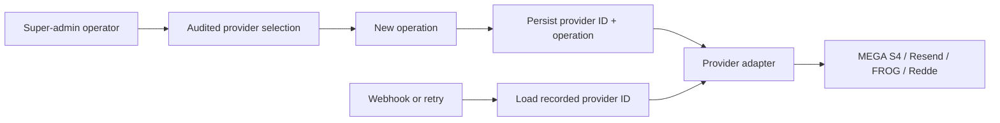

# Provider integrations: agent handoff

**Status:** specification and plan; no integration code has been changed by this package.  
**Decision:** [agreed design](../2026-09-21-provider-integrations-design.md).  
**Sources of truth:** [PRD §13](../../../BACKEND-PRD.md#13-provider-integrations--phase-5), [API contract](../../../API-CONTRACT.md), [frontend types](../../../Frontend/src/types/index.ts), and the module architecture documents linked below. This package expands the new PRD requirements; it does not replace existing payment, ownership, preview, audit, or notification rules.

## Read in this order

1. [Repository rules](../../../AGENTS.md), [project memory](../../../CLAUDE.md), [agent SDLC](../../../backend/docs/sdlc/agent-workflow.md), and [branch/PR policy](../../../backend/docs/sdlc/branching-and-pr.md).
2. [Requirements and acceptance scenarios](requirements.md).
3. [Architecture and migration specification](architecture.md).
4. [Configuration and activation matrix](configuration-matrix.md).
5. [Implementation work units and file map](implementation-plan.md).
6. The relevant module architecture document: [platform](../../../backend/docs/architecture/analytics-audit-platform.md), [media](../../../backend/docs/architecture/media.md), [payments](../../../backend/docs/architecture/payments.md), [notifications](../../../backend/docs/architecture/notifications.md), [identity](../../../backend/docs/architecture/identity.md), [admin](../../../backend/docs/architecture/admin.md).

Claim only a `todo` work unit whose `depends_on` entries are `done` in the [backlog](../../../backend/.project/backlog.yaml). Existing completed WUs stay completed. Follow one work unit per branch and PR. Do not allocate migration numbers from this plan; use [`next-migration-version.sh`](../../../backend/scripts/next-migration-version.sh) and the [migration policy](../../../backend/docs/cross-cutting/data-and-migrations.md) at implementation time.

`WU-EXT-1` creates the selection control; `WU-EXT-2` makes it authoritative for payments. Do not expose a production payment-selection switch or activate Redde between those merges. Similarly, keep S4 selection unavailable for production writes until `WU-EXT-4` records durable media locations.

## What “plugin” means here

Each external service is an outbound adapter behind an application port. A controlled provider selection chooses the adapter for a **new** operation. The provider ID is then persisted on the operation or asset so all later activity uses the same provider. This is a Quarkus adapter registry, not dynamic JAR loading or an OpenCode/Codex plugin. Credentials remain deployment secrets. Production payment selection has an explicit `disabled` value; turning Redde off cannot create a fake sandbox settlement.

## Graphify navigation

The local [Graphify report](../../../graphify-out/GRAPH_REPORT.md) and [graph data](../../../graphify-out/graph.json) are **ignored generated artifacts**. The report was built from commit `ba0641aa`; the checkout was `fecef8b` when this package was authored. Refresh with `graphify update .` before relying on graph edges. Graphify helps discover call paths; the links below point to source files and remain authoritative when the generated graph is absent or stale. Do not add `graphify-out/` to a PR.

| Trace | Start here | Follow to |
| --- | --- | --- |
| Upload to storage | [MediaApplicationService](../../../backend/src/main/java/org/shakvilla/beatzmedia/media/application/service/MediaApplicationService.java) | [ObjectStorePort](../../../backend/src/main/java/org/shakvilla/beatzmedia/media/application/port/out/ObjectStorePort.java) → [S3ObjectStoreAdapter](../../../backend/src/main/java/org/shakvilla/beatzmedia/media/adapter/out/integration/S3ObjectStoreAdapter.java) → [S3ClientProducer](../../../backend/src/main/java/org/shakvilla/beatzmedia/media/adapter/out/integration/S3ClientProducer.java) |
| Playback delivery | [MediaService](../../../backend/src/main/java/org/shakvilla/beatzmedia/media/application/port/out/MediaService.java) | [UrlSignerPort](../../../backend/src/main/java/org/shakvilla/beatzmedia/media/application/port/out/UrlSignerPort.java) → [MediaDeliveryIT](../../../backend/src/test/java/org/shakvilla/beatzmedia/media/it/MediaDeliveryIT.java) |
| Payment initiation/reconciliation | [PaymentGateway](../../../backend/src/main/java/org/shakvilla/beatzmedia/payments/application/port/out/PaymentGateway.java) | [PaymentGatewayRouter](../../../backend/src/main/java/org/shakvilla/beatzmedia/payments/adapter/out/integration/PaymentGatewayRouter.java) → [ReddePaymentGateway](../../../backend/src/main/java/org/shakvilla/beatzmedia/payments/adapter/out/integration/redde/ReddePaymentGateway.java) → [PaymentIntentEntity](../../../backend/src/main/java/org/shakvilla/beatzmedia/payments/adapter/out/persistence/PaymentIntentEntity.java) |
| Payment callbacks | [PaymentWebhookResource](../../../backend/src/main/java/org/shakvilla/beatzmedia/payments/adapter/in/rest/PaymentWebhookResource.java) | [HandleReddeReceiptService](../../../backend/src/main/java/org/shakvilla/beatzmedia/payments/application/service/HandleReddeReceiptService.java) → [PaymentReconJob](../../../backend/src/main/java/org/shakvilla/beatzmedia/payments/adapter/in/job/PaymentReconJob.java) |
| Notification delivery | [DeliveryAttemptService](../../../backend/src/main/java/org/shakvilla/beatzmedia/notifications/application/service/DeliveryAttemptService.java) | [DeliveryAttemptEntity](../../../backend/src/main/java/org/shakvilla/beatzmedia/notifications/adapter/out/persistence/DeliveryAttemptEntity.java) → [SmtpMailer](../../../backend/src/main/java/org/shakvilla/beatzmedia/notifications/adapter/out/integration/SmtpMailer.java) / [HttpSmsSender](../../../backend/src/main/java/org/shakvilla/beatzmedia/notifications/adapter/out/integration/HttpSmsSender.java) |
| Identity email | [RequestPasswordResetService](../../../backend/src/main/java/org/shakvilla/beatzmedia/identity/application/service/RequestPasswordResetService.java) | [identity Mailer](../../../backend/src/main/java/org/shakvilla/beatzmedia/identity/application/port/out/Mailer.java) → [SmtpPasswordResetMailer](../../../backend/src/main/java/org/shakvilla/beatzmedia/identity/adapter/out/integration/SmtpPasswordResetMailer.java) |
| Provider control | [FeatureFlagsAdapter](../../../backend/src/main/java/org/shakvilla/beatzmedia/platform/adapter/out/persistence/FeatureFlagsAdapter.java) | [FeatureKey](../../../backend/src/main/java/org/shakvilla/beatzmedia/platform/domain/FeatureKey.java) → [AdminSettingsResource](../../../backend/src/main/java/org/shakvilla/beatzmedia/admin/adapter/in/rest/AdminSettingsResource.java) → [AuditWriter](../../../backend/src/main/java/org/shakvilla/beatzmedia/audit/application/port/out/AuditWriter.java) |

## Completion rule

Each work unit updates its owning module ADD and any relevant ADR in the same PR, passes [testing gates](../../../backend/docs/sdlc/testing-strategy.md) and [verify/smoke scripts](../../../backend/scripts/verify.sh), and records the exact provider behavior observed in a sandbox. Live credentials and production activation are separate operational gates. No agent should claim success from mocked provider responses alone.
