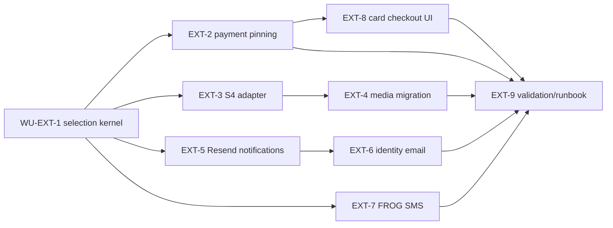

# Provider integrations: work-unit implementation plan

**For OpenCode implementers:** follow [agent workflow](../../../backend/docs/sdlc/agent-workflow.md), [requirements](requirements.md), and [architecture](architecture.md). Claim a ready `WU-EXT-*` from [backlog](../../../backend/.project/backlog.yaml); one owner, branch, and PR per WU. The file links below are a starting map, not permission to bypass graph tracing or touch unrelated work. Refresh local Graphify with `graphify update .` because [its current report](../../../graphify-out/GRAPH_REPORT.md) was built from an older commit. Before each PR, update the relevant module ADD and add an ADR if the actual design departs from this spec.

## Dependency graph

Independent branches after EXT-1 may run concurrently only after EXT-1 is merged. Shared [application.properties](../../../backend/src/main/resources/application.properties), [API-CONTRACT.md](../../../API-CONTRACT.md), and Compose edits need conflict coordination. Do not edit a migration created by another branch; allocate a fresh version in the owning module band. `WU-EXT-9` is a documentation and validation work unit, not permission to deploy or turn on live charges without the merchant credentials and rollout evidence.

## WU-EXT-1 — Provider selection kernel

**Requirements:** LLFR-EXT-01.1–01.4. **Depends on:** completed WU-PLT-1, WU-AUD-1, WU-ADM-8. **Owner module:** platform, with thin admin inbound adapter. **Outcome:** audited runtime selection of a configured provider for new operations; payment defaults to disabled in production.

- **Trace:** [FeatureFlagsAdapter](../../../backend/src/main/java/org/shakvilla/beatzmedia/platform/adapter/out/persistence/FeatureFlagsAdapter.java), [FeatureKey](../../../backend/src/main/java/org/shakvilla/beatzmedia/platform/domain/FeatureKey.java), [AdminSettingsResource](../../../backend/src/main/java/org/shakvilla/beatzmedia/admin/adapter/in/rest/AdminSettingsResource.java), [AuditWriter](../../../backend/src/main/java/org/shakvilla/beatzmedia/audit/application/port/out/AuditWriter.java), [admin ADD](../../../backend/docs/architecture/admin.md), [platform ADD](../../../backend/docs/architecture/analytics-audit-platform.md).
- **Design:** define capability/provider codes and a platform input port to read/set selection, a persistence port for versioned rows, and a readiness SPI that provider adapters can implement without revealing secrets. Keep `PSP_REDDE` semantics in place until EXT-2 migrates payment routing; document the temporary precedence rule explicitly. Keep the payment selection control unavailable to production operators until EXT-2 is merged. Add the proposed super-admin operational API to the API contract and OpenAPI checks. A stale `expectedVersion` or unready target is rejected with no selection change.
- **Migration:** platform-owned `provider_selection`; explicit safe seed for each capability, no secret columns. Choose the next free version at implementation time.
- **Tests:** allowed/denied RBAC, invalid code, missing row, missing credentials, stale version, concurrent updates, audit exactly once, safe response redaction, `%prod` sandbox rejection. Include a test that a failed activation leaves old selection intact.
- **Done when:** selection can be read/changed safely, and all existing flows still run on their pre-EXT-1 adapters. No real provider is implicitly activated.

## WU-EXT-2 — Payment vendor pinning and safe disable

**Requirements:** LLFR-EXT-01.3 and LLFR-EXT-05.1–05.3. **Depends on:** EXT-1, WU-PAY-7. **Owner:** payments-specialist. **Outcome:** every new charge/payout records the gateway vendor once; later work never consults the current selection for that operation.

- **Trace:** [PaymentGatewayRouter](../../../backend/src/main/java/org/shakvilla/beatzmedia/payments/adapter/out/integration/PaymentGatewayRouter.java), [PaymentIntent](../../../backend/src/main/java/org/shakvilla/beatzmedia/payments/domain/PaymentIntent.java), [PaymentIntentEntity](../../../backend/src/main/java/org/shakvilla/beatzmedia/payments/adapter/out/persistence/PaymentIntentEntity.java), [PayoutTxnEntity](../../../backend/src/main/java/org/shakvilla/beatzmedia/payments/adapter/out/persistence/PayoutTxnEntity.java), [ReddePaymentGateway](../../../backend/src/main/java/org/shakvilla/beatzmedia/payments/adapter/out/integration/redde/ReddePaymentGateway.java), [PaymentWebhookResource](../../../backend/src/main/java/org/shakvilla/beatzmedia/payments/adapter/in/rest/PaymentWebhookResource.java), [payment ADD](../../../backend/docs/architecture/payments.md).
- **Design:** pick vendor once per operation, persist before outbound action, and carry it through direct versus hosted checkout choice, status query, callback verification, recon, and payouts. Keep rail enablement separate. Make `disabled` reject initiation without invoking sandbox or Redde. Preserve old Redde callbacks when disabled. Retire `PSP_REDDE` as a router authority once migration is complete, with an explicit compatibility path for existing deployments.
- **Migration:** payments-owned gateway vendor fields on `payment_intent` and `payout_txn`; classify existing active rows from reliable evidence. Ambiguous active rows are reported and block switching; do not force a guessed backfill.
- **Tests:** [router tests](../../../backend/src/test/java/org/shakvilla/beatzmedia/payments/adapter/out/integration/PaymentGatewayRouterTest.java), [Redde gateway tests](../../../backend/src/test/java/org/shakvilla/beatzmedia/payments/adapter/out/integration/redde/ReddePaymentGatewayTest.java), [Redde webhook IT](../../../backend/src/test/java/org/shakvilla/beatzmedia/payments/it/ReddeWebhookIT.java), [payout flow IT](../../../backend/src/test/java/org/shakvilla/beatzmedia/payments/it/PayoutFlowIT.java). Add mid-flight switch, duplicate callback, no-double-disbursement, and ambiguous historical row cases. A dedicated verification agent checks money and ownership invariants under the SDLC playbook.
- **Done when:** a Redde intent/payout completes through Redde after the current selection becomes `disabled`; a new request is rejected; ledger entries are balanced and idempotent.
- **Progress (2026-10-28):** implementation is present in the working tree: new charge/tip/payout selection and vendor pinning; callbacks, receipts, and reconciliation use the stored vendor; disabled blocks new operations; ambiguous pre-migration active rows are tagged `unknown` and fail closed. Java 25 Maven compile succeeded. Required integration checks remain outstanding.
- **Done when:** a Redde intent/payout completes through Redde after the current selection becomes `disabled`; a new request is rejected; legacy `unknown` rows are evidence-reconciled; ledger entries are balanced and idempotent; required integration checks pass.

## WU-EXT-3 — MEGA S4 compatible adapter

**Requirements:** LLFR-EXT-02.1–02.2. **Depends on:** EXT-1, WU-MED-2. **Owner:** backend-engineer, media. **Outcome:** new assets can be written to a configured S4 store while MinIO tests stay green.

- **Trace:** [S3ClientProducer](../../../backend/src/main/java/org/shakvilla/beatzmedia/media/adapter/out/integration/S3ClientProducer.java), [S3ObjectStoreAdapter](../../../backend/src/main/java/org/shakvilla/beatzmedia/media/adapter/out/integration/S3ObjectStoreAdapter.java), [FfmpegAudioTranscoderAdapter](../../../backend/src/main/java/org/shakvilla/beatzmedia/media/adapter/out/integration/FfmpegAudioTranscoderAdapter.java), [ImageArtworkProcessorAdapter](../../../backend/src/main/java/org/shakvilla/beatzmedia/media/adapter/out/integration/ImageArtworkProcessorAdapter.java), [media ADD](../../../backend/docs/architecture/media.md).
- **Design:** provider-specific S3 client/presigner configuration with region, internal endpoint, public endpoint, key pair, and bucket mapping. Preserve upload size, magic-byte validation, private originals, preview renditions, and signed GET. Avoid unsupported S4 checksum and presigned POST features only after testing the repo's SDK request behavior.
- **Migration:** none unless needed for provider-specific configuration metadata; durable asset location belongs to EXT-4. Keep EXT-3 selection S4-disabled in production until EXT-4 allows old/new mixed reads.
- **Tests:** MinIO regressions including [retryable body test](../../../backend/src/test/java/org/shakvilla/beatzmedia/media/adapter/out/integration/S3ObjectStoreAdapterRetryableBodyTest.java) and [delivery IT](../../../backend/src/test/java/org/shakvilla/beatzmedia/media/it/MediaDeliveryIT.java); optional credentialed S4 sandbox test for PUT/HEAD/GET/DELETE, 500 MB path, transformed artwork, signed browser URL, range GET, expiry, and checksum headers. A skipped credentialed test is not evidence of S4 readiness.
- **Done when:** real S4 endpoint passes compatibility checks and MinIO remains the default local/test provider.
- **Progress (2026-10-29):** dual S3-compatible clients and presigners now support MinIO and MEGA S4 configuration. New object references persist a store code; old `bucket|key` values remain MinIO-readable. Original upload, delivery write, object reads, deletion, and presigned delivery select the recorded/current store. Transcoding and artwork processing now go through the object-store port, allowing mixed-store assets. Java 25 Maven compile succeeds. Credentialed S4 compatibility checks remain, so production readiness remains blocked.

## WU-EXT-4 — Durable media locations and migration

**Requirements:** LLFR-EXT-02.3–02.4. **Depends on:** EXT-3. **Owner:** backend-engineer, media. **Outcome:** existing and new assets can coexist across stores, with resumable verified copying.

- **Trace:** [MediaAssetEntity](../../../backend/src/main/java/org/shakvilla/beatzmedia/media/adapter/out/persistence/MediaAssetEntity.java), [MediaAssetMapper](../../../backend/src/main/java/org/shakvilla/beatzmedia/media/adapter/out/persistence/MediaAssetMapper.java), [MediaApplicationService](../../../backend/src/main/java/org/shakvilla/beatzmedia/media/application/service/MediaApplicationService.java), [MediaImageResource](../../../backend/src/main/java/org/shakvilla/beatzmedia/media/adapter/in/rest/MediaImageResource.java), [media pipeline](../../../backend/docs/cross-cutting/media-pipeline.md).
- **Design:** persist a location before writing new objects; route all reads, transcoding, art processing, signing, and deletion by the recorded location. Create a copy manifest/checkpoint and a dry-run inventory covering originals, covers, full, preview, and lossless keys. Copy, verify bytes/hash, atomically switch location, and retain source objects for rollback. Failed copy keeps source authoritative.
- **Migration:** media-owned store/location field(s) and checkpoint table. Backfill only from confirmed deployment storage inventory; no remote object copy inside Flyway.
- **Tests:** mixed-store reads after restart, upload while selection changes, interrupted copy, corrupt/missing destination, signed preview/full authorization, art URL stability, rollback to source. Execute a small S4 migration rehearsal with count/size/hash report.
- **Done when:** a default-store flip cannot make any existing asset unreadable, and dry-run/copy/rollback instructions are reproducible.
- **Progress (2026-10-29):** media references now preserve provider identity for new writes and decode legacy references as MinIO, enabling mixed-store reads without changing the `media_asset` schema. Bulk inventory, verified copy, checkpointing, and rollback tooling remain.

## WU-EXT-5 — Resend notification transport

**Requirements:** LLFR-EXT-03.1, 03.3. **Depends on:** EXT-1, WU-NOT-2. **Owner:** backend-engineer, notifications plus shared email transport. **Outcome:** new notification attempts can use Resend; retries remain pinned.

- **Trace:** [notifications Mailer](../../../backend/src/main/java/org/shakvilla/beatzmedia/notifications/application/port/out/Mailer.java), [EmailMessage](../../../backend/src/main/java/org/shakvilla/beatzmedia/notifications/application/port/out/EmailMessage.java), [SmtpMailer](../../../backend/src/main/java/org/shakvilla/beatzmedia/notifications/adapter/out/integration/SmtpMailer.java), [DeliveryAttemptService](../../../backend/src/main/java/org/shakvilla/beatzmedia/notifications/application/service/DeliveryAttemptService.java), [DeliveryAttemptEntity](../../../backend/src/main/java/org/shakvilla/beatzmedia/notifications/adapter/out/persistence/DeliveryAttemptEntity.java), [notification ADD](../../../backend/docs/architecture/notifications.md).
- **Design:** expose shared transactional email sending behind a module input port so identity can use it in EXT-6 without reading notifications tables. Select and persist provider at attempt creation; pass stable Resend idempotency key; track provider message ID and acceptance separately from final delivery. Keep SMTP/Mailpit. If webhooks are enabled, verify raw-body signature and deduplicate before applying terminal status.
- **Migration:** notifications-owned provider/message reference and optional provider event table; existing pending attempts need evidence-based attribution.
- **Tests:** queued SMTP attempt survives switch, Resend attempt retries with same key/payload, 429/5xx versus permanent errors, accepted versus delivered, duplicate/bad-signature webhook, opt-out, no PII logs, [NotificationFlowIT](../../../backend/src/test/java/org/shakvilla/beatzmedia/notifications/it/NotificationFlowIT.java).
- **Done when:** email attempt state stays correct across provider changes and Resend sandbox sends confirm payload/domain behavior.
- **Progress (2026-10-29):** Resend HTTP transport, selected email transport router, per-attempt provider pinning, acceptance-ID persistence, idempotency header, and V984/V985 migrations are implemented in the working tree. Identity password-reset sends now use the same selected transport with a stable token-derived idempotency key. Java 25 Maven compile succeeds. Delivery webhooks and credentialed sandbox verification remain.

## WU-EXT-6 — Identity email on selected transport

**Requirements:** LLFR-EXT-03.2. **Depends on:** EXT-5, WU-IDN-2. **Owner:** backend-engineer, identity. **Outcome:** password reset uses the selected transactional provider without changing token security or enumeration behavior.

- **Trace:** [identity Mailer](../../../backend/src/main/java/org/shakvilla/beatzmedia/identity/application/port/out/Mailer.java), [SmtpPasswordResetMailer](../../../backend/src/main/java/org/shakvilla/beatzmedia/identity/adapter/out/integration/SmtpPasswordResetMailer.java), [RequestPasswordResetService](../../../backend/src/main/java/org/shakvilla/beatzmedia/identity/application/service/RequestPasswordResetService.java), [identity ADD](../../../backend/docs/architecture/identity.md).
- **Design:** identity calls the shared email input port through an adapter; choose provider per new reset send. Preserve single-use token expiry, generic HTTP response for known/unknown account, and no token/address logging. If queuing is selected, persist an operation ID and provider before dispatch and state how token expiry interacts with delayed delivery.
- **Migration:** only if durable send tracking is required by the chosen queue design; no change to existing reset tokens without an explicit test.
- **Tests:** known/unknown accounts same observable response, new request makes new message, retry does not duplicate one request, switch between requests chooses new provider, no token in logs.
- **Done when:** both SMTP local and Resend sandbox password-reset flows work end to end.

## WU-EXT-7 — FROG SMS transport

**Requirements:** LLFR-EXT-04.1–04.3. **Depends on:** EXT-1, WU-NOT-2. **Owner:** backend-engineer, notifications. **Outcome:** FROG sends and callbacks have correct provider-specific semantics.

- **Trace:** [SmsSender](../../../backend/src/main/java/org/shakvilla/beatzmedia/notifications/application/port/out/SmsSender.java), [HttpSmsSender](../../../backend/src/main/java/org/shakvilla/beatzmedia/notifications/adapter/out/integration/HttpSmsSender.java), [SmsMessage](../../../backend/src/main/java/org/shakvilla/beatzmedia/notifications/application/port/out/SmsMessage.java), [delivery retry job](../../../backend/src/main/java/org/shakvilla/beatzmedia/notifications/application/service/DeliveryRetrySweepJob.java), [notification ADD](../../../backend/docs/architecture/notifications.md).
- **Design:** dedicated FROG client with documented headers/body and response parser. Persist stable `msgid` and selected provider on enqueue. Map callback to attempt by `msgid`; apply monotonic state updates and deduplication. Keep capture sender in Compose. Until callback authentication and repeat-`msgid` behavior are confirmed, classify callback as advisory and ambiguous timeout as needs-reconciliation rather than blind retry.
- **Migration:** notification attempt provider/reference from EXT-5 can be reused; add only needed callback event metadata.
- **Tests:** fixture payload/header comparison, approved sender validation, normalized phone, `ACCEPTD`/`DELIVRD`/failure transitions, repeated/out-of-order callbacks, timeout, unknown `msgid`, unauthenticated callback, no phone in logs, local capture regression.
- **Done when:** one sandbox SMS send and callback are observed with vendor-confirmed security/retry behavior, or the unresolved behavior is explicitly gated from production activation.

## WU-EXT-8 — Hosted card checkout client completion

**Requirements:** LLFR-EXT-05.4. **Depends on:** EXT-2, WU-COM-2. **Owner:** frontend-developer. **Outcome:** frontend follows Redde hosted checkout URL and waits for server settlement.

- **Trace:** [checkout route](../../../Frontend/src/routes/checkout.index.tsx), [checkout completion route](../../../Frontend/src/routes/checkout.complete.tsx), [commerce queries](../../../Frontend/src/lib/api/queries/commerce.ts), [API mappers](../../../Frontend/src/lib/api/mappers.ts), [types](../../../Frontend/src/types/index.ts), [contract](../../../API-CONTRACT.md).
- **Design:** consume the existing optional `checkoutUrl` wherever it is surfaced in the checkout/order response. Redirect only to a validated provider HTTPS URL from the server; on return, poll the order/payment status through the API. Show pending/failure honestly, never grant ownership locally. Preserve the existing checkout flow for MoMo and free orders.
- **Tests:** `npm run build`, targeted Vitest checkout tests, browser return/pending/settled/failure scenarios, no duplicate charge on refresh/back navigation.
- **Done when:** hosted card checkout reaches server-confirmed receipt without front-end-only paid state.

## WU-EXT-9 — Sandbox evidence, runbook, and release gate

**Requirements:** all NFRs and [canonical scenarios](requirements.md#canonical-acceptance-scenarios). **Depends on:** EXT-2, EXT-4, EXT-6, EXT-7, EXT-8. **Owner:** tech lead plus payments verifier. **Outcome:** a repeatable activation and rollback runbook with evidence for all four providers.

- **Trace:** [deployment environment guide](../../../backend/docs/sdlc/environments-and-deployment.md), [CI checks](../../../backend/docs/sdlc/ci-cd-github-actions.md), [Compose stack](../../../backend/docker-compose.yml), [verify script](../../../backend/scripts/verify.sh), [smoke script](../../../backend/scripts/smoke.sh).
- **Deliverables:** sanitized configuration matrix, readiness checklist, S4 dry-run/copy report, Resend verified-domain/send evidence, FROG callback/retry confirmation, Redde merchant sandbox charge/checkout/cashout evidence, metric/alert thresholds, and switch/rollback steps. Identify exactly which merchant/account credentials and DNS/callback settings operations must supply; never store values in the repo.
- **Gate:** local full verification, CI required checks, browser smoke, and a separate adversarial payment verifier. Production activation is a distinct privileged operational action after the evidence and deploy secrets are available. The runbook records any unresolved provider behavior as a blocker for that provider only.

## Common PR checklist

For each WU: link its LLFR IDs, list exact files/migrations, update module ADD and ADR where needed, preserve API contract or make additive edits with contract tests, run focused tests and then `cd backend && bash scripts/verify.sh && bash scripts/smoke.sh` for backend changes, and record any provider sandbox evidence. The existing uncommitted working-tree changes are unrelated; do not include them in a WU PR. See [branch/PR policy](../../../backend/docs/sdlc/branching-and-pr.md) and [testing strategy](../../../backend/docs/sdlc/testing-strategy.md).
